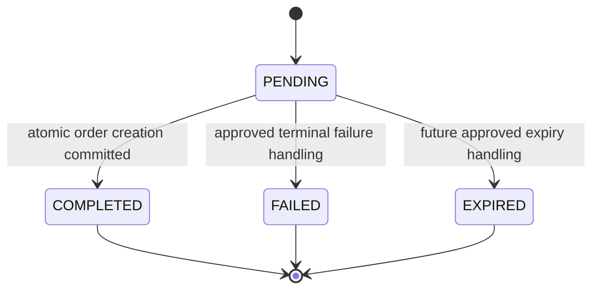
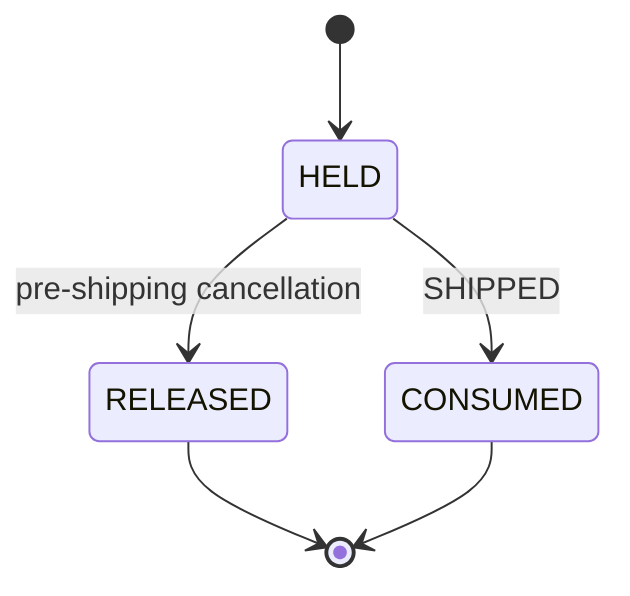

# Checkout V1 — Phase 1 data foundation

Prepared for review on 2026-10-17 (Asia/Bangkok). **Migration NOT deployed. No database writes.**

Later deployment attempt: see [deployment report](checkout-v1-phase1-deployment.md). The approved SQL guard failed; schema/business data remain unchanged, but Prisma now has an unfinished migration record. The "no database writes" statement above describes the original preparation phase only.

## Scope and files

- `prisma/schema.prisma`: nullable guest email, shipping and item snapshots, two models/enums and inverse relations.
- [Migration SQL](../prisma/migrations/20261017000000_checkout_v1_foundation/migration.sql): generated from two local Prisma schemas, then augmented with Development identity/TLS guards and SQL CHECK constraints.
- `prisma.checkout.config.ts`: offline-only Prisma configuration; no environment or real credential loading. Only validate/generate/format and schema-to-schema diff are permitted. It rejects migrate deploy/dev/reset and db commands. The diff engine requires a URL; an unreachable loopback placeholder is used, never a Development/production fallback.
- `scripts/checkout-phase1-preflight.ts`: only `--check-readonly`, uses exclusively `KONO_MEDIA_DEV_DATABASE_URL` and existing media Development guards.
- `src/features/checkout/foundation.ts` and `.test.ts`: strict validation, hashing, canonical fingerprints, retry inspection and pure reservation transition plans. No Prisma client, writer, endpoint or worker.
- `DashboardOverview.tsx` and `RecentOrdersCard.tsx`: only widen email type to `string | null`, required after generation. No UI or behavior changes. Orders admin, Payment and SePay implementation files are unchanged.
- This document.

Existing unrelated working-tree changes were preserved. No `/checkout`, checkout POST API, Order, Payment, CartItem or reservation has been created. No production access, environment/credential changes, migration deployment, commit or push.

## Approved policy, not active runtime behavior

Guest checkout, COD only, optional email. Proposed Development shipping is 30,000 VND per order nationwide. This is represented in an explicitly Development-only proposal constant; it is not a SQL default or active shipping service and must not silently become production policy.

Hold time is 24 hours. `proposedHoldExpiry()` is a pure UTC date calculation. `expiresAt` supports future review/indexed queries; passing it **does not release stock or cancel an order**. No scheduler or automatic expiry action is introduced. COD expiry handling still requires a separate approved process.

## READ ONLY Development preflight

Verified before application-table reads:

| Identity | Verified value |
| --- | --- |
| Project | hidden-forest-64993760 |
| Branch | br-proud-field-b3xjljxh |
| Endpoint | ep-lucky-fire-b3froe7u |
| Database/schema | neondb/public |
| TLS | authorized, sslmode=verify-full |
| Transaction | REPEATABLE READ, READ ONLY |

The script sets default_transaction_read_only=on at connection establishment, sets search_path=public, verifies server-reported Neon identity, and fails closed. It never reads DATABASE_URL as a fallback. A missing/expired/mismatched Development connection stops work; no alternative branch is created.

Before and final preflights both found 7 Orders, 7 OrderItems, 3 Inventory rows and 7 Payments. Five existing migrations were completed, with no unfinished migration. The new tables did not exist. No invalid negative monetary values, invalid inventory values, nonpositive item quantities or inconsistent item totals were found. Final migration history, column metadata, constraints and counts matched the initial report.

Only aggregates/schema metadata were retained in ignored local `.kono-backups/checkout-phase1/` files; no customer PII was logged. Matching counts are not a row-by-row data equality proof; database non-mutation follows from the strictly read-only connections and absence of any application writer invocation.

## Schema before → after

### Order

Previously: optional userId/addressId, mandatory customerEmail, no structured guest shipping snapshot.

Now: customerEmail is nullable. Existing strings are untouched. Nine nullable fields are added: recipientName, recipientPhone, provinceCode, provinceName, wardCode, wardName, addressLine, countryCode, shippingMethod. Existing shippingAmount is reused; it remains integer VND with no new default.

All nine fields null identifies a legacy order. Otherwise the database CHECK requires all nine populated, nonempty recipient/address names and codes, VN country and STANDARD shipping method. Future method/country expansion requires a reviewed change. No User/Address is synthesized; notes remain notes. Existing Address, Shipment and Payment models/relations are unchanged.

The new-order helper requires a complete snapshot, COD and VND, validates recipient details, and accepts missing/null email. It intentionally does not validate legacy orders as new orders. Administrative address codes must still be verified against an approved source by a future shipping service; Phase 1 only validates their shape.

### OrderItem

Existing productName, sku, quantity, unitPrice and totalPrice are reused. Nullable colorName and sizeName are added. A new order writes scalar copies, independent of later ProductVariant/color/size renames. Legacy fields stay null; do not guess historical selections from current variant names.

### CheckoutAttempt

- id; ownerHash/keyHash/requestFingerprint/quoteFingerprint, each a lowercase 64-character SHA-256 digest.
- status: PENDING, COMPLETED, FAILED, EXPIRED.
- nullable unique orderId (Order FK, ON DELETE RESTRICT); no PII response JSON.
- createdAt, updatedAt, expiresAt, completedAt.
- unique `(ownerHash, keyHash)` scopes key reuse to the guest owner.
- index `(status, expiresAt)` supports pending/expired review.

ownerHash uses the existing hashed guest session identity, not the raw cookie. keyHash is derived from a sufficiently random opaque client idempotency key. Fingerprints are digests, not authorization credentials: hashes of low-entropy personal data are not encryption. Do not log them unnecessarily.

The future server must normalize its typed request, sort cart lines consistently, and fingerprint all significant inputs including the approved quote fingerprint, method, address and quantities. `fingerprint()` sorts object keys recursively, preserves array ordering and rejects non-JSON data. Never fingerprint arbitrary unsanitized browser objects or trust client-provided totals.

### InventoryReservation

- orderItemId unique: **at most one reservation ever per OrderItem**, stronger than one active reservation. Terminal rows are not recycled.
- inventoryId FK, positive integer quantity.
- status: HELD, RELEASED, CONSUMED.
- expiresAt, createdAt, updatedAt, releasedAt, consumedAt.
- indexes `(inventoryId, status)` and `(status, expiresAt)`.
- Both FKs use ON DELETE RESTRICT, preserving traceability even for finalized reservations. Consequently deletion of an Order/Inventory with reservation history is intentionally blocked; archive/reconcile instead.

No legacy reservation is created. The future writer must verify Inventory.variantId matches OrderItem.variantId and reservation quantity matches the OrderItem. Simple FKs/CHECK constraints cannot enforce these cross-table business rules or ensure reserved equals the sum of held reservations. No trigger is added to silently mutate inventory.

## Integrity constraints and SQL review

The migration is one explicit BEGIN/COMMIT transaction with 5-second lock timeout and 60-second statement timeout. An SQL guard checks all five approved Development identifiers and TLS via pg_stat_ssl before schema changes. The artifact is intentionally Development-pinned; it will fail on production or an unapproved shadow/other branch. Future production/replay portability requires a separately reviewed deployment strategy, not weakening this guard during this task.

It adds nullable columns, two enums, two empty tables, six indexes and three FKs. `customerEmail DROP NOT NULL` is the only DROP keyword in executable SQL; it relaxes nullability, not a table/column/type/data deletion. There is no INSERT, data UPDATE, DELETE, TRUNCATE, backfill or Inventory column rewrite.

Reviewed migration SHA-256: `00a2f7546d76215c687163e5e80f2cae0cb75a5305fe970d23aa4915062d0f5e`. The final offline Prisma schema diff was compared with the generated portion of the migration and matched.

SQL-only CHECK constraints:

- Inventory: quantity/reserved/lowStockAt >= 0 and reserved <= quantity.
- Order: monetary fields >= 0.
- OrderItem: quantity > 0, prices >= 0 and totalPrice = quantity * unitPrice. SQL multiplication is cast to bigint to avoid integer overflow while checking.
- Order snapshot: absent legacy snapshot or complete supported snapshot.
- CheckoutAttempt: digest shape, expiresAt > createdAt; COMPLETED requires orderId and completedAt >= createdAt, other states prohibit both.
- Reservation: quantity > 0, expiresAt > createdAt; terminal timestamp matches status and is not earlier than creation, no contradictory terminal timestamp.

CHECK constraints on existing tables are added NOT VALID then explicitly VALIDATEd in the same transaction. Preflight found no violating rows; deploy-time validation catches changes since preflight and rolls back rather than repairing them. ALTER TABLE still takes locks; NOT VALID is not a promise of zero blocking. PostgreSQL Int limits money/quantity to 2,147,483,647; helper validation also enforces the upper bound and order/line arithmetic.

Prisma cannot express these CHECKs in the datamodel. Preserve them in migration history and review future diffs; Prisma validate alone does not prove SQL CHECK behavior. Database checks enforce valid states, not immutable snapshots or legal transition history. Future services must enforce those under locks/conditional writes.

## CheckoutAttempt lifecycle



Terminal states do not transition. Same owner/key with a different request or quote fingerprint is a conflict. COMPLETED replay returns the same orderId even after expiresAt; it never re-runs checkout. A PENDING retry waits/reports pending, not another Order. Failed/expired attempts require a new key for a new attempt. Phase 1's helper returns an expiry outcome without writing EXPIRED or releasing anything.

The future transaction must claim the unique owner/key, serialize concurrent attempts and persist Order/result together. A failed transaction rolls back the claim and all business changes; recording a terminal FAILED attempt separately would need an explicit future design. Different keys still require Cart locks and re-reading CartItems so two tabs cannot place the same consumed cart twice.

Do not delete completed idempotency records merely because their quote expired. Retention/key reuse rules need approval before any cleanup worker is introduced. The owner hash is not a public confirmation credential; guest confirmation access is deferred.

## InventoryReservation and Order lifecycle — future implementation



| Future action | Order/Reservation | Inventory delta in same transaction |
| --- | --- | --- |
| Cart/quote | no reservation | none |
| Create order | PENDING + HELD | reserved += item quantity |
| Confirm/process | reservation stays HELD | none |
| Ship | SHIPPED + CONSUMED | quantity -= q; reserved -= q |
| Cancel before shipping | CANCELLED + RELEASED | reserved -= q |
| Time passes beyond 24h | no automatic change | none |
| Refund after delivery | no automatic restock | reviewed physical return process only |

`planReservationTransition()` is pure: it gives an expected `{id, status: HELD}` condition, timestamp update and deltas. A repeated identical terminal action gives zero deltas; the opposite terminal action fails. **This helper alone is not concurrency protection.** Future code must lock the Order and relevant rows in a documented stable order, apply the conditional reservation transition and inventory deltas atomically, and only change stock when exactly one HELD row transitioned. Failure rolls back all effects. Reservation creation similarly requires available-stock checks/conditional updates under transaction locks. No such writer is implemented in Phase 1.

Current Orders admin and inventory CRUD do not yet implement this lifecycle. Checkout must remain unavailable until those paths are upgraded and tested together. Payment status and shipment/order status must not be treated as interchangeable.

## Legacy handling

Seven existing Orders and their items remain unchanged. They have no CheckoutAttempt/reservation or new shipping/color/size snapshots. No current inventory reserved value is attributed to those orders automatically. Phase 2+ must explicitly distinguish new managed orders from legacy orders and fail closed/manual-review when reservation ownership is absent. Never infer that canceling a legacy order should release or replenish inventory. Keep existing payment/shipment records untouched.

## Validation performed

- Prisma format/validate/generate using the isolated offline config: PASS.
- TypeScript --noEmit: PASS after two Dashboard email-type widenings.
- ESLint on every changed TypeScript/TSX file: PASS.
- 40 offline tests: PASS (11 Phase 1 tests plus Cart, Inventory and existing SePay service/webhook regressions). Existing tests use in-memory adapters/mocks; no real Order/Payment/Inventory writes.
- Tests cover guest/no User, optional email, legacy Prisma input compatibility, scalar snapshots, money/quantity validation, canonical fingerprints, owner/key/payload conflicts, completed replay, unique/FK declarations, reservation state plans and repeat/cross-terminal actions, no production fallback, offline command restrictions and migration safety contract.

No SQL migration execution or live PostgreSQL concurrency/constraint-insert test was run. Static schema/SQL checks and pure helper tests do not substitute for these tests; they require separate approval in an isolated approved environment. Generated Prisma Client is local/ignored and is ahead of live Development. Do not deploy/restart application flows that select new columns before approved migration deployment.

## Approval boundary and future deployment verification

**STOP here: approval is required before migrate deploy.** This task does not provide an enabled deployment command/config. Do not use prisma.config.ts, plain `prisma migrate deploy`, migrate dev, db push, or the existing Media migration runner for this artifact. No current preflight option can write.

After separate approval, prepare/review a deploy runner that uses only KONO_MEDIA_DEV_DATABASE_URL, existing URL/identity guards and strict TLS, checks expiry/identity immediately, lists all pending migrations and compares the reviewed SQL checksum. Only this one reviewed migration may be pending. Never relax identity checks or switch branches to get past a failure. The offline config intentionally refuses deployment.

Before deploy: repeat READ ONLY preflight, compare existing migration checksums/history and schema with the reviewed baseline; inspect pending migrations; pause application writers; record an approved encrypted backup/recovery point and verify restore access. The current ignored schema/aggregate reports are **not a data backup**.

After deploy, run the same guarded preflight:

```powershell
.\node_modules\.bin\tsx.cmd scripts/checkout-phase1-preflight.ts --check-readonly
```

Verify: exact identity/TLS/readOnly; one newly completed migration; nullable email and nine nullable shipping columns, two nullable item columns; new enums/tables/indexes/FKs/CHECKs with convalidated=true; both new tables empty; original row counts and secured baseline fingerprints unchanged; Inventory.quantity/reserved unchanged; no legacy snapshots/reservations synthesized. The preflight prints columns/constraints/history and aggregate validity, but does not automatically assert all after-deploy expectations; compare them explicitly and inspect pg_indexes for the six named indexes. Keep Checkout/SePay disabled. Do not create test orders without separate write-test approval.

## Rollback and recovery

Prisma has no automatic down-migration command. Nothing needs database rollback now because nothing was deployed.

1. Failure before COMMIT: SQL DDL/check changes roll back as one PostgreSQL transaction. Verify actual schema and migration ledger read-only; a lost COMMIT response is ambiguous until inspected. Prisma's migration bookkeeping can record a failed attempt outside the SQL transaction. Do not blindly re-run or edit the ledger.
2. If schema is demonstrably unchanged and the new migration is recorded failed, a separately approved, guarded recovery may mark only that failed migration rolled back via Prisma migrate resolve, then retry the reviewed artifact. Resolve does not undo SQL.
3. If deployment succeeded and no foundation data has been written, prefer leaving additive columns/tables in place and reverting application usage. If physical reversal is required, first prove new tables empty, every new snapshot column null, and no customerEmail null. Then obtain approval for a new compensating migration: remove only new constraints/indexes/FKs/tables/enums/columns and restore email NOT NULL. It must not contain CASCADE or alter stock. Do not change the SQL of an already applied migration or mark a successful migration rolled back.
4. If any new checkout data exists, do not drop structures or fabricate missing emails. Pause writers, preserve an encrypted export and use a reviewed forward repair or coordinated restore from the verified pre-deploy recovery point. A restore may lose intervening unrelated writes; reconcile them first. No automatic branch creation/restore is authorized.

Unresolved before future launch: real PostgreSQL transactional tests; Cart-to-Order writer; expiry/manual COD procedure; official address lookup; guest confirmation authorization; shipping/production policy; legacy inventory reconciliation; admin inventory concurrency; idempotency retention. None is silently implemented by this schema migration.
